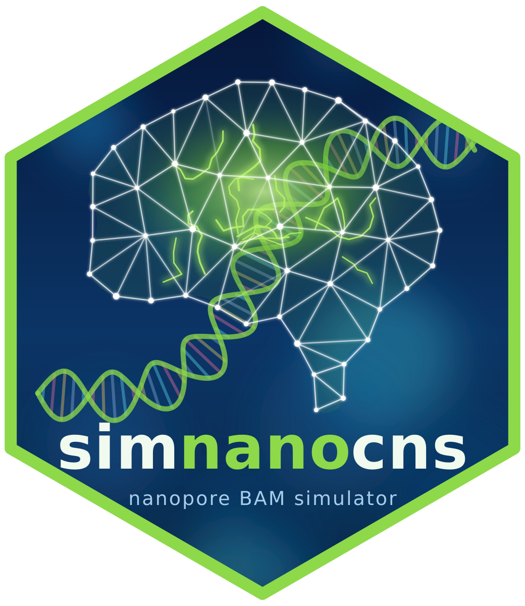

# SimNanoCNS 
Simulate Nanopore BAMs of brain tumours and test Rapid-CNS2_nf

 * simulator of BAM file
 * modificator: add mutation, CNV modification, 
 * Quality adjustment: add noise or reduce the deep artificially

 * Interface GUI to launch the pipeline RapîdCNS2 (tkinter) and for the simulation (streamlite)
 * Documentations in French and English.

NOTA: This project is developed with the help of AI (Claude, Anthropic), under active review by Pierre Bady.
